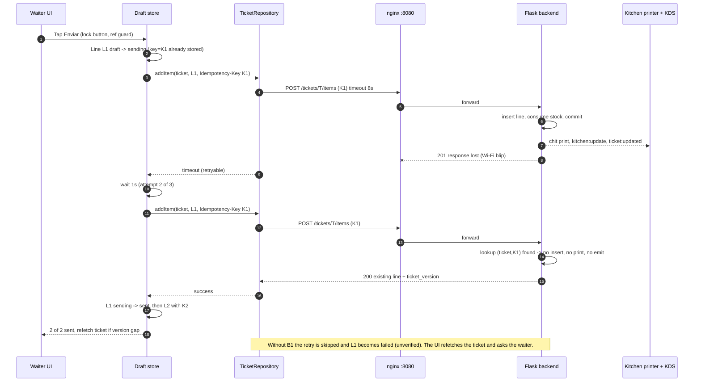
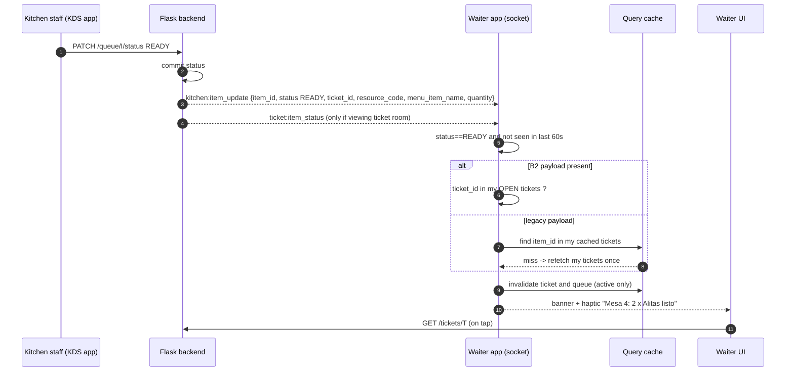
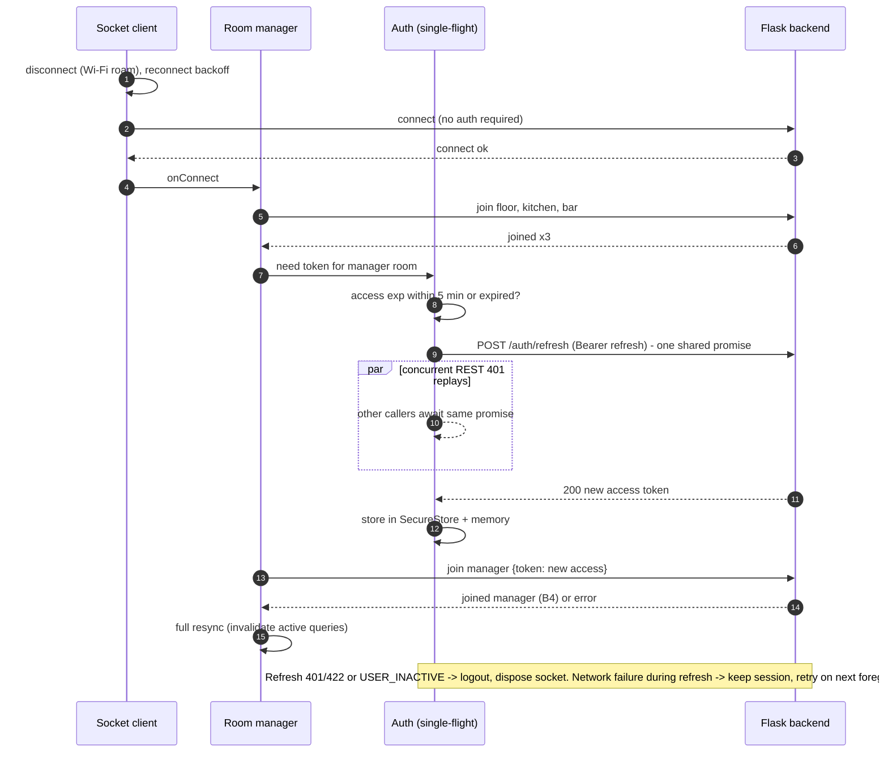

# Networking and Sync

Status: Accepted (elaborates D6, D7, D8, B1, B2, B4). Source facts: `discovery/API_CAPABILITY_MATRIX.md` sections 0, 9, 11; `REPOSITORY_AUDIT.md` sections 4, 6; `frontend/nginx.conf`.

Principle: **REST is the truth, the socket is a hint.** Socket payloads (mostly `{}`) only trigger refetches over authenticated REST. The single exception is the ready notification, which reads a few fields from the payload (B2) and falls back to a refetch when they are absent.

## 1. Server URL configuration and health validation (D8)

1. First launch (or after "Cambiar servidor"): the user types host[:port]. Normalise: add `http://` if no scheme, default port `8080` when none is given, strip trailing `/`, strip a pasted `/api/v1`.
2. Policy check (implemented, `serverUrlProblem` in `serverConfig.ts`): `https://` is accepted for any host; `http://` only for private/LAN hosts: 10/8, 172.16/12, 192.168/16, 127/8, 169.254/16, Tailscale 100.64/10 and `*.ts.net` (MagicDNS), `localhost`, `*.local` and the emulator alias `10.0.2.2`. Anything else is rejected with a Spanish validation message and no request is made. A bare host defaults to `:8080` for http; `https://` without a port stays 443; explicit ports are kept.
3. Validate with `GET {base}/api/v1/health`, 4 s timeout, no auth, no retry. Accept only HTTP 200 with JSON `status === "ok"`. Anything else gets a specific message: DNS/unreachable (check Wi-Fi, same network, firewall), timeout, non-JSON (wrong host, captive portal), JSON without `status` (not a POS).
4. If the health body contains `api_features` (proposed additive field, see INTEGRATION_STRATEGY P2), store it as the capability set, for example `idempotency-key`, `socket-payload-v2`, `manager-room`. Absent means "assume none".
5. Persist `serverUrl` in AsyncStorage (non-secret). Changing the server clears tokens, the query cache and drafts after confirmation.
6. Emulator: `http://10.0.2.2:8090` reaches the dockerised `billarmobile` project. A physical phone uses the POS host LAN IP and port 8080.
7. The connection-lost banner always offers "Cambiar servidor" because a DHCP change (section 11) is the most likely cause of a permanent outage.

## 2. REST client

Layer: `src/api/client.ts`, a port of the web `api/client.ts` with an absolute `baseURL = {serverUrl}/api/v1`, rebuilt when the URL changes.

| Concern | Rule |
|---|---|
| Timeout | 8 s per request (axios `timeout`). Health 4 s. No global request queue |
| Auth header | `Authorization: Bearer <access>` from the auth store (memory copy of SecureStore value) |
| Error normalisation | Every failure becomes `AppError {kind, status?, code?, message, retryable}`. `kind`: `network`, `timeout`, `auth`, `forbidden`, `conflict`, `validation`, `rate_limit`, `server`, `unknown`. Handles `{error,message}`, `{error}` only, `{msg}` (JWT lib), HTML bodies (404/500/502), plain 429 and 413 (G17) |
| GET retry | Up to 2 retries on `network`, `timeout`, 502/503/504. Backoff 500 ms then 1500 ms, +/-30% jitter. Never retry 4xx. 429: honour `Retry-After` once, else show cooldown |
| Mutation retry | **Never automatic.** Exception: item-send with an idempotency key (section 3) |
| 401 | Single-flight refresh (section 4), then replay the original request once. Safe for mutations because the JWT check runs before any handler, so a 401 means nothing was applied |
| Backend restarting | nginx answers 502 while gunicorn boots; treated as retryable for GET, as "server unavailable" for mutations |
| DELETE with body | Void sends `pin` in a DELETE body. Verify on RN/XHR in a contract test (see INTEGRATION_STRATEGY); fallback is a thin repository workaround, not a server change |

TanStack wiring: `retry: (n, e) => n < 2 && e.retryable`, `retryDelay` as above; mutations `retry: 0`.

## 3. Mutation safety: duplicate taps and the send flow

Layers of protection (all of them, not either/or):

1. **UI lock:** the button reads `isPending` and is disabled with a spinner.
2. **Synchronous guard:** `isPending` updates asynchronously, so two taps in one frame can both pass. Handlers also check a `useRef` "in flight" flag set before the first `await`.
3. **Action registry:** an in-memory set keyed `action:target` (for example `request-payment:<ticketId>`) rejects a second concurrent call.
4. **Idempotency (items only):** each draft line carries a UUID `client_request_id`, created when the line is added to the draft, sent as `Idempotency-Key` (B1).
5. **State-based server guards for the rest:** open-table is protected by `uq_tickets_open_per_resource` (409 `RESOURCE_OCCUPIED`). After an ambiguous failure the app GETs `/tickets?status=OPEN&resource_id=X`; if the open ticket's `opened_by` is the current user, adopt it instead of showing an error. `request-payment` and `clear-payment-request` are state-based and safe to repeat. EXPRESS/DELIVERY creation has no guard (G13); it is out of scope for v1 waiter flows.

Draft line states (persisted in zustand + AsyncStorage): `draft` -> `sending` -> `sent`, or `failed`. Rules:
- Lines whose outcome is **uncertain** (`sending`, or `failed` with network / timeout / 5xx / verify, or any line that was attempted at least once and not definitively rejected) are **locked**: no quantity, notes, modifier or delete action. Only "Reintentar" is offered, or "Descartar" after a dialog in which the waiter confirms they checked the ticket. A line that was never attempted, or that the server definitively rejected (422 `OUT_OF_STOCK`, `FLAVOR_REQUIRED`, `INVALID_QUANTITY`), stays editable and keeps its key. Editing an uncertain line would reuse a key with different content, and a B1 replay ignores the body (SEC-12).
- Sending is sequential, in draft order, one line at a time. Stop at the first non-retryable failure and report `n of m sent`; sent lines are not rolled back (v1 sends per line, D5/D6).
- **Both headers are sent on every add**: `Idempotency-Key` (the draft line key, never regenerated) and `X-Ticket-Version`. Each draft line persists `firstAttemptVersion`, the `X-Ticket-Version` of its first POST (written before the request leaves, so an app kill keeps it); each ticket persists `b1Confirmed`, set the first time any add response contains `ticket_version`.
- **Retry of an uncertain line, B1 confirmed:** same key; the version may be refreshed. On 409 `VERSION_CONFLICT` refresh once and retry once with the same key (the server decides replay before the version check, so this cannot duplicate); a second 409 marks the line "Verifica en la cuenta" and stops.
- **Retry of an uncertain line, B1 not confirmed:** same key AND the line's `firstAttemptVersion`, never a refreshed one. If the first attempt landed, the ticket version moved, so the retry gets 409; the line is marked "Verifica en la cuenta" and the run stops. The app never refreshes the version, never resends automatically and never offers "Reintentar" on a `verify` line. If the first attempt had no version header the line is not re-posted at all. Net effect: without B1 an ambiguous failure can produce at most one add.
- Invalid key: B1 answers **422** `INVALID_IDEMPOTENCY_KEY` (keys match `[A-Za-z0-9_-]{1,64}`, column `VARCHAR(64)`).
- On app restart, any `sending` line is treated as ambiguous (`failed`/network) and handled by the same rules.

Printing note (not a mobile bug): the backend auto-prints a kitchen chit per `POST /items` (and a bar chit if enabled). A six-line send produces six chits and six socket bursts. Flagged in INTEGRATION_STRATEGY as proposal P5 (batch endpoint).

## 4. Token handling and single-flight refresh

- Tokens live in SecureStore; the auth store holds a memory copy plus the non-secret `user`.
- Access token lifetime is 8 h (hard-coded server side), refresh 7 d. Refresh is **reactive** (on 401) and **proactive on foreground**: if `exp` of the access token is within 5 minutes, refresh before the first request. `exp` is read from the JWT payload (base64 decode, no verification needed for scheduling).
- Single-flight: one module-level `refreshPromise`. Concurrent 401s await the same promise. After success: store the new access token (refresh token is not rotated), replay queued requests, resolve the socket's pending join. On refresh 401/422 or `USER_INACTIVE`: logout (clear tokens, cache, socket) and route to login with "session expired". On network failure during refresh: do **not** logout; fail the request with `network` and keep the session.
- The role is a claim snapshot (G25). After each refresh, re-read `GET /auth/me` and, if the role changed, rebuild navigation and socket rooms.
- 429 on login/verify-pin: show a countdown, never auto-retry. Login and verify-pin share a bucket across **all** phones and the web UI (no ProxyFix; see SECURITY_MODEL).

## 5. Socket.IO client

Server: Flask-SocketIO 5.3.6 on eventlet, one gunicorn worker, no namespaces, nginx at `:8080` with `Upgrade` headers and `proxy_read_timeout 3600`. Engine.IO v4 is compatible with `socket.io-client` ^4.8.

```ts
io(serverUrl, {
  path: '/socket.io',
  transports: ['websocket', 'polling'],  // websocket first; RN has native WebSocket
  tryAllTransports: true,                // fall back to polling if websocket is blocked (client >= 4.6; verify in contract test)
  autoConnect: false,
  reconnection: true,
  reconnectionDelay: 1000,
  reconnectionDelayMax: 10000,
  randomizationFactor: 0.5,
  timeout: 8000,
});
```

Lifecycle:
- Created once per (serverUrl, user session); `connect()` called after login, `disconnect()` + dispose on logout or server change.
- Engine ping defaults (25 s interval, 20 s timeout) detect a dead link within roughly 45 s. The UI treats `connect_error` and `disconnect` as "reconnecting", not as an error dialog.
- **Every `connect` event (first and reconnects) re-runs room joins and a full resync** (invalidate all active queries), as the web does. The server forgets rooms on disconnect.
- Background: when AppState leaves `active` for more than 30 s, disconnect deliberately (Android Doze would otherwise leave a zombie socket). On return to `active`: connect, rejoin, resync.

### Rooms by role

| Role | Rooms joined | Reason |
|---|---|---|
| everyone | `floor` | `floor:update`, `waiting:update`, `waiting_list:update` are emitted there |
| WAITER | `kitchen`, `bar` | Ready notifications (`<station>:item_update`); public rooms, so no token needed. Queue screens are not mounted, so these events cost no refetches except the notification handler |
| KITCHEN_STAFF | `kitchen` | KDS |
| BAR_STAFF | `bar` | KDS |
| MANAGER / ADMIN | `kitchen`, `bar`, `manager` (with `token`) | Oversight; `print:failed`. `manager` only works after B4 |
| any, while a ticket screen is focused | `ticket:<id>` | `ticket:updated`, `ticket:item_status`. Join on focus, `leave` on blur/unmount |

Join emits `join {room}` (and `token` for `manager`); the server replies `joined {room}` or `error {msg}`. Treat `error` for `manager` as "no manager notifications", not as a failure of the app. If the access token is expired, refresh first, then join (diagram 3).

### Event to query-invalidation map

Query keys: `['resources']`, `['ticket', id]`, `['tickets', filter]`, `['queue', 'kitchen'|'bar']`, `['queue','counts']`, `['waiting-list']`, `['settings', key]`, `['menu', ...]`, `['stock-check']`, `['cash','status']`. All invalidations use `refetchType: 'active'`, so unmounted screens refetch lazily.

| Socket event | Payload today (after B2) | Action |
|---|---|---|
| `connect` | n/a | Invalidate every active query; rejoin rooms |
| `floor:update` | `{}` | `['resources']`, `['tickets','mine']` (open ticket badges), `['cash','status']` (open ticket count) |
| `waiting:update`, `waiting_list:update` | `{}` | `['waiting-list']`. Listen to both names (G16) |
| `ticket:updated` | `{ticket_id, version?}` | `['ticket', ticket_id]`; if cached version >= `version`, skip refetch; `['tickets', ...]` |
| `ticket:item_status` | `{item_id, status}` (+ `ticket_id, resource_code, menu_item_name, quantity` after B2) | `['ticket', ticket_id]`; before B2 use the currently viewed ticket id (joined room is the only source) |
| `kitchen:update`, `bar:update` | `{}` | `['queue', station]`, `['queue','counts']` |
| `kitchen:item_update`, `bar:item_update` | `{item_id, status}` or `{item_id, needs_reprint}` (+ B2 fields) | Patch the cached queue item status optimistically if present, then invalidate `['queue', station]`. Events without `status` are reprint flags: invalidate only. Run the ready handler (section 6) |
| `pool:timer_voided` | `{ticket_id, resource_id, session_id, ticket_closed}` | `['ticket', ticket_id]`, `['resources']`, `['tickets', ...]` |
| `settings:changed` | `{key, value}` | `setQueryData(['settings', key], value)` |
| `print:failed` (manager) | `{job_id, ticket_id \| queue_item_id, type, error}` | Manager alert banner; `['ticket', ticket_id]` |
| `inventory:box_opened` | broadcast | Ignored in v1 (`['stock-check']` optional) |
| `inventory:box_finished/low` | never emitted | Not mapped |

## 6. Ready notification (waiter)

Trigger: `kitchen:item_update` or `bar:item_update` with `status === 'READY'`.
- With B2: the payload carries `ticket_id` (never `opened_by`, SEC-05: the rooms are public). "Mine" = `ticket_id` is in the set of OPEN tickets whose `opened_by` is the current user (`GET /tickets?status=OPEN`, cached under the `resources` key so every `floor:update` refreshes it). Other waiters' ready items only appear in the Listos list. Show an in-app banner "Mesa {resource_code}: {quantity} x {menu_item_name} listo", haptic pulse, and optional sound. Tapping opens the ticket.
- Without B2 (payload is `{item_id, status}` only, so no `ticket_id`): the app only refetches the lists (no toast). The original plan was to look up `item_id` in cached tickets of the current user (`['tickets','mine']`, `['ticket', id]`). If found, notify; if not found, refetch `['tickets','mine']` once and re-check; if still not found, stay silent (it belongs to someone else).
- Dedupe by `item_id:READY` for 60 s so reconnect resyncs and duplicate emits do not re-alert.
- **Limitation (documented, accepted for v1):** there is no push. Notifications work while the app is in the foreground with a live socket. Backgrounded or screen-off phones get nothing until foreground, then a resync shows READY chips and an "x items ready" indicator. FCM is out of scope (D2, no external services). Revisit with a foreground service only if bars report missed alerts.
- Items are `READY` also when a waiter's own tickets show `READY` at resync time; the banner for resync-discovered READY items is a single summary, not N alerts.

## 7. App state, connectivity and staleness

- **AppState foreground:** on `active`: refresh token if near expiry, `connect()` the socket if disconnected, `queryClient.invalidateQueries({ refetchType: 'active' })`. Throttle to once per 5 s.
- **Connectivity (implemented in `src/realtime/connectivity.ts`):** the bar LAN normally has no internet, so connectivity is **never** internet reachability. **Online = the POS answers `GET {base}/api/v1/health` (HTTP 200) OR the socket is connected.** Until the first probe finishes the app trusts the link (`isConnected`) alone. The app (1) calls `NetInfo.configure({ reachabilityUrl: '{base}/api/v1/health', reachabilityTest: r => r.status === 200, useNativeReachability: false, short/long timeouts 5 s / 20 s })` at boot and again whenever the server URL changes, and (2) runs its own health probe (4 s timeout) on every NetInfo change, on foreground and every 20 s. TanStack `onlineManager.setOnline` is driven by the combined value, and `OfflineBanner` / `useConnectionLevel` use the same rule. Socket down while the POS answers health shows "reconnecting" and keeps mutations enabled; neither `isInternetReachable` nor the OS "validated" flag is read.
- **Connection state machine** (`connectionStore`): `online` (reachable and socket connected), `degraded` (reachable, socket down), `offline` (not reachable), `unknown` (booting). Combine with REST failures: three consecutive `network`/`timeout` errors force `offline` until the next success.
- **Banners (top of every screen, one at a time, highest priority first):** DEMO DATA (D13) > offline "Sin conexion al POS - mostrando datos de {hh:mm}" (red) > reconnecting "Reconectando..." (amber) > none. Online but a query older than 60 s shows a subtle per-screen "Actualizado hace Xs" chip (`dataUpdatedAt`), not a banner.
- **Stale indicators:** every list/detail screen shows `StaleBadge` driven by `dataUpdatedAt` and `isFetching`; when offline, content is dimmed slightly and write buttons show a lock with the reason.
- **Mutations never pause.** TanStack's default `networkMode: 'online'` would pause a mutation while offline and silently run it on reconnect, which is an implicit offline queue and forbidden by D7/ADR-005. Configure `mutations: { networkMode: 'always', retry: 0 }`, call `resumePausedMutations` nowhere, and exclude mutations from persistence (`dehydrateOptions.shouldDehydrateMutation: () => false`).

## 8. Cache policy

Defaults: `gcTime` 24 h (needed so the persisted cache survives), `retry` as section 2, `refetchOnReconnect: 'always'`, `refetchOnWindowFocus` unused (AppState handler does it), `networkMode: 'offlineFirst'` for queries (serve cache, still try the network; matches web).

| Query | staleTime | Socket-driven | Persisted to disk |
|---|---:|---|---|
| `/auth/me` | 5 min | no | no (user is in the auth store) |
| `/menu/categories`, `/menu/items`, `/menu/modifiers` | 10 min | no | yes (needed to compose a draft offline) |
| `/inventory/stock-check` | 30 s | `floor:update` optional | no |
| `/resources` | 30 s | `floor:update` | yes |
| `/tickets/<id>` | 10 s | `ticket:updated`, `ticket:item_status` | yes (open tickets only) |
| `/tickets?status=OPEN` (mine) | 15 s | `floor:update` | yes |
| `/queue/kitchen`, `/queue/bar` | 5 s | `*:update`, `*:item_update` | no (a stale kitchen queue is dangerous) |
| `/queue/counts` | 5 s | same | no |
| `/waiting-list` | 30 s | `waiting:update` | no |
| `/settings/<key>` | 5 min | `settings:changed` | yes |
| `/cash/status` | 60 s | `floor:update` | no |
| Manager lists (`open-all`, reports) | 30 s | none | no |

Persistence uses an allow-list `dehydrateOptions.shouldDehydrateQuery` (menu, resources, my open tickets, settings), `maxAge` 24 h, `buster` = app version + serverUrl hash. Cleared on logout and server change. Customer names live in cached tickets: acceptable on a staff phone, but it is why logout wipes the cache.

## 9. Offline matrix (D7)

"Offline" means the POS is unreachable (section 7), whether or not the phone has Wi-Fi.

| Action | Offline behaviour |
|---|---|
| View floor / table list | Read from cache with offline banner and "last updated" |
| View open ticket (lines, total) | Read from cache; total labelled "last known" |
| View menu / modifiers | Read from cache |
| Compose order draft (add, edit, remove lines) | **Allowed**, persisted locally (`draft` lines) |
| Send draft (Enviar) | **Blocked** with reason; draft kept; auto-offer to send when back online, never auto-send |
| Open ticket, transfer, customer name, promo decision | Blocked |
| Request bill / clear request | Blocked |
| Void line / decrease qty (PIN) | Blocked |
| KDS status change (start/ready/served) | Blocked; queue shown read-only from the last memory copy, with a prominent stale warning |
| Manager actions (discount, cash, reports) | Blocked; cached reads where persisted |
| Login | Blocked (needs server). An existing session keeps working in read-only mode while offline |
| Logout | Allowed locally (clear tokens/cache); the server `logout` call is best effort |
| Change language, change server URL | Allowed |

Reconnect: banner turns green "Conectado" for 2 s, a full resync runs, drafts are listed as "pending send" and the waiter taps Enviar. Nothing is replayed automatically.

## 10. Sequence diagrams

### 10.1 Send order with idempotent retry (B1)



### 10.2 Ready notification



### 10.3 Token refresh during socket reconnect



## 11. LAN pitfalls and operations

| Pitfall | Effect | Mitigation |
|---|---|---|
| AP/client isolation (guest SSID) | Phones cannot reach the POS at all | Put staff phones on the SSID/VLAN that includes the POS; health failure message names this |
| Windows Firewall / network profile on the POS host | Port 8080 blocked when the Wi-Fi/Ethernet profile is "Public" | Inbound rule for 8080 on the active profile; verify from a phone browser first |
| DHCP IP change on the POS host | App silently loses the server | **Recommend a DHCP reservation on the bar router** (or static IP via `scripts/set_ip.ps1`); app shows "Cambiar servidor" on persistent failure |
| Wi-Fi without internet | Android may mark the network "no internet" and route traffic to mobile data; connections to a LAN IP can then fail | Staff phones: keep the "stay connected" choice, or disable mobile data on the bar SSID, or give the router internet. NetInfo uses the POS health URL, not the internet |
| Wi-Fi power save / Doze | Sockets die when the screen is off | Foreground-only design, deliberate disconnect after 30 s, resync on resume; KDS tablets: `expo-keep-awake`, charger, battery optimisation off |
| AP roaming between access points | Brief drop, same IP | Reconnect backoff plus resync handle it |
| nginx timeouts | `/api/` 60 s read, socket 3600 s | Client timeout 8 s is well inside; long polling not used when websocket works |
| Single gunicorn worker | One slow handler stalls everyone | Keep client timeouts short, no aggressive polling (no interval refetch; sockets plus foreground refetch only) |
| mDNS hostnames (`pos.local`) | Unreliable on Android apps | Use IP; hostnames only if the router provides DNS |
| Private DNS / VPN apps on phones | Break LAN reachability | Staff phone setup checklist in LOCAL_DEV_ENVIRONMENT / ops docs |
| Shared login rate-limit bucket | Many phones logging in at shift start can hit 10/min | See SECURITY_MODEL; proposal P1 (ProxyFix) |
