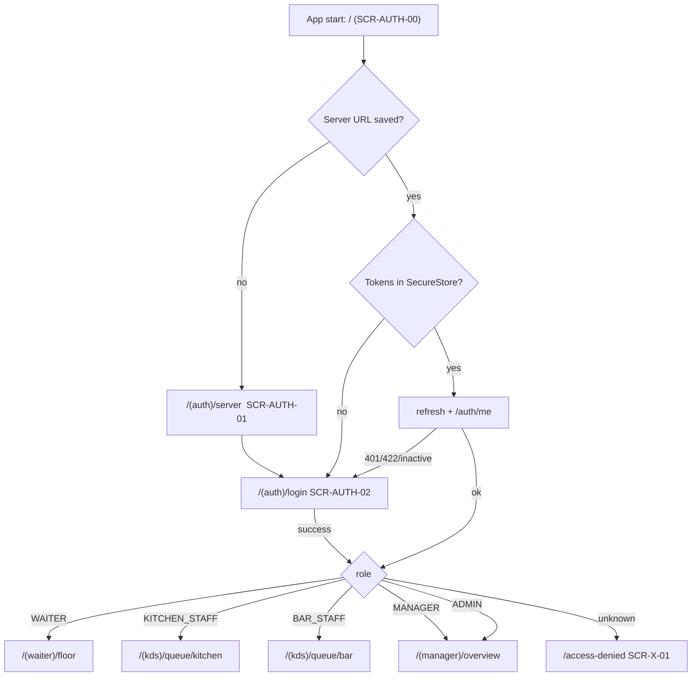
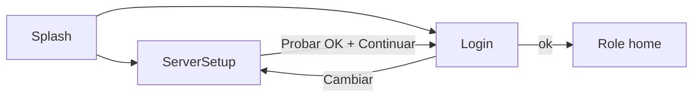
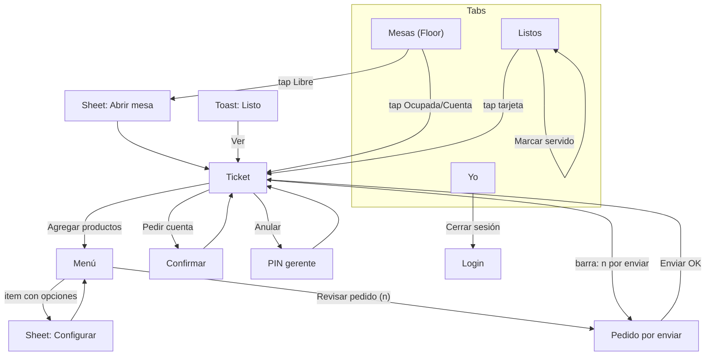
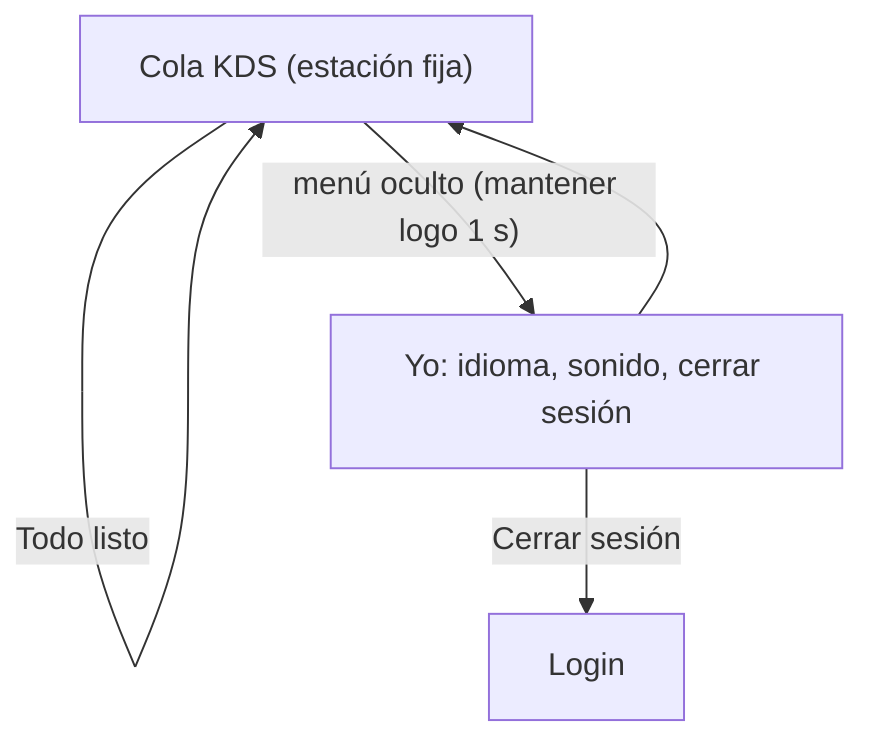
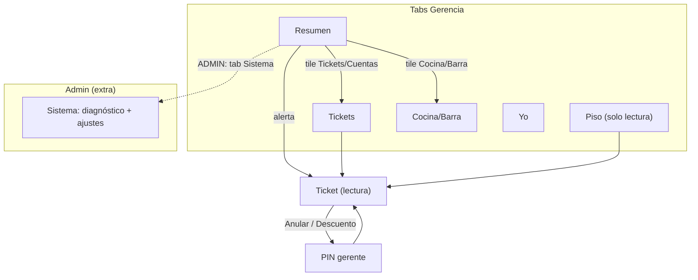

# Navigation Architecture

expo-router (file-based). One auth gate at the root, then **one navigator tree per role family**. Screen IDs refer to [SCREEN_INVENTORY.md](./SCREEN_INVENTORY.md).

## 1. Information architecture

```
Bola 8 Companion
├── Acceso (signed out)      server setup · login
├── Mesero  (WAITER)         Mesas · Listos · Yo   (+ ticket stack: ticket → menú → configurar → pedido por enviar)
├── Cocina / Barra (KDS)     una sola pantalla de cola (sin tabs); Yo por menú oculto
├── Gerencia (MANAGER)       Resumen · Tickets · Piso · Cocina/Barra · Yo
└── Admin (ADMIN)            = Gerencia + Sistema
```

Principle: **the home of each role is the one screen they use 90 % of the time; everything else is ≤ 2 taps.** Waiter = Floor; KDS = queue; Manager = overview.

## 2. Tab vs stack decisions

| Area | Pattern | Why |
|---|---|---|
| Waiter root | **Bottom tabs** (3): Mesas, Listos (badge), Yo | Two daily destinations + account; Listos must be one tap from anywhere, with a count badge |
| Ticket → Menu → Draft | **Stack** pushed over tabs (tab bar hidden inside the ticket flow, replaced by BottomActionBar) | It is a task with a start and an end; the action bar needs the bottom edge; avoids accidental tab switches mid-order |
| Item configurator | **Modal bottom sheet** (`presentation: 'transparentModal'`) | Contextual to the grid; dismiss = back to the same scroll position |
| Open table, PIN, confirm | Sheet / dialog overlays (not routes where possible) | No history pollution; resolve with a promise |
| KDS | **Single screen, no tabs** (stack of 1) | Zero ways to drift away from the queue; kiosk-like; station switch is a segmented control not a tab |
| Manager root | **Bottom tabs** (5). MANAGER: Resumen, Tickets, Piso, Cocina/Barra, Yo. ADMIN: Resumen, Tickets, Piso, Sistema, Yo (KDS reachable from Resumen tiles) | ≤ 5 tabs (Material guideline); admin diagnostics matter more to the admin than a KDS peek |
| Splash / auth | **Stack**, no tabs | Linear |

Landscape: waiter and manager tab bars stay at the bottom; KDS switches to horizontal card scroller and a 48 dp top bar (orientation unlocked only on KDS; waiter/manager portrait-locked to avoid layout complexity in v1).

## 3. Root gate and role routing (D9)



Route guard: each group `_layout.tsx` checks `role ∈ allowed`; mismatch → `/access-denied` (never a blank screen, never silent redirect).

| Role | Allowed groups | Home | Tabs |
|---|---|---|---|
| WAITER | `(waiter)` | `/(waiter)/floor` | Mesas · Listos · Yo |
| KITCHEN_STAFF | `(kds)` (station kitchen only) | `/(kds)/queue/kitchen` | none |
| BAR_STAFF | `(kds)` (station bar only) | `/(kds)/queue/bar` | none |
| MANAGER | `(manager)`, `(kds)` view | `/(manager)/overview` | Resumen · Tickets · Piso · Cocina/Barra · Yo |
| ADMIN | `(manager)` incl. `system`, `(kds)` view | `/(manager)/overview` | Resumen · Tickets · Piso · Sistema · Yo |

## 4. Navigation maps per role

### 4.1 Auth



### 4.2 Waiter



### 4.3 Kitchen / Bar



### 4.4 Manager / Admin



## 5. Deep links

Scheme `bola8://` (Android intent filter + iOS later). Links are resolved **after** auth gate; a cold link while signed out stores the target, runs login, then navigates (target survives server setup too).

| Link | Target | Used by | Guard |
|---|---|---|---|
| `bola8://ticket/{ticketId}` | `/(waiter)/ticket/{id}` (manager: `/(manager)/tickets/{id}`) | Ready toast / local notification tap | role W/M/A; ticket not OPEN → ErrorState "Esta cuenta ya no está abierta" |
| `bola8://ready` | `/(waiter)/ready` | Notification "N listos" | W |
| `bola8://kds/{kitchen\|bar}` | `/(kds)/queue/{station}` | Launcher shortcut for KDS tablets/phones | K/B only their station; M/A any; else X-01 |
| `bola8://floor` | home for waiter/manager | shortcut | W/M/A |
| `bola8://server?url=…` | AUTH-01 prefilled | **Disabled in release** (avoids pointing the app at a rogue host); debug only | — |

Android app shortcuts (long-press icon): "Mesas", "Listos", "Cocina". Push (FCM) is out of scope — local notifications only (app foreground/background socket); documented limitation: a fully killed app gets no ready alerts.

## 6. Back behaviour

| Situation | Back does |
|---|---|
| Sheet / dialog / PIN open | Closes it (sending state: ignored, except Draft which continues in background) |
| Configurator | Close sheet, return to Menu scroll position |
| Menu → Ticket | Pops; **draft preserved** (persisted); Ticket shows "n productos por enviar" bar |
| Draft | Pops to Menu |
| Ticket | Pops to Floor (tab restored, scroll kept) |
| Tab root (Mesas) | First press: Toast "Presiona otra vez para salir"; second within 2 s exits app. Other tab roots go to the home tab first |
| KDS root | **Ignored** (haptic only) — prevents a greasy-thumb exit; leave via menu → Cerrar sesión or system Home |
| Login / ServerSetup | Login back → ServerSetup only if no session history; ServerSetup is the stack root on first launch |
| Access denied | Back → role home (replace, not push) |
| Auth expiry mid-flow | Replace-stack to Login, store `returnTo`; after login return to same ticket (draft untouched) |

State preservation: floor query cache survives tab switches (TanStack gcTime 1 h); ticket/draft state keyed by `ticketId` and persisted (MMKV/AsyncStorage) so a crash, call or app switch never loses a draft; drafts of other users are wiped on logout (see state matrix).

## 7. Real-time & navigation interplay

- Joining rooms follows the visible screen: Floor → `floor`; Ticket → `ticket:<id>`; KDS → `kitchen`|`bar`; Manager overview → `floor`,`kitchen`,`bar`. Leave on blur to save battery, except the "ready watcher" (waiter, any tab): subscribes to `kitchen`+`bar` and filters to own tickets so the toast works anywhere.
- When the socket drops, screens keep their data; focus-effect refetch on screen focus and on `AppState → active` guarantee eventual consistency (D8).
