# Role-Based User Flows

Mermaid flowcharts. Screen IDs: [SCREEN_INVENTORY.md](./SCREEN_INVENTORY.md). API behaviour: [BUSINESS_RULES.md](../discovery/BUSINESS_RULES.md), [API_CAPABILITY_MATRIX.md](../discovery/API_CAPABILITY_MATRIX.md). Decisions D5–D10: [PROJECT_STATE.md](../PROJECT_STATE.md).

## 1. First launch

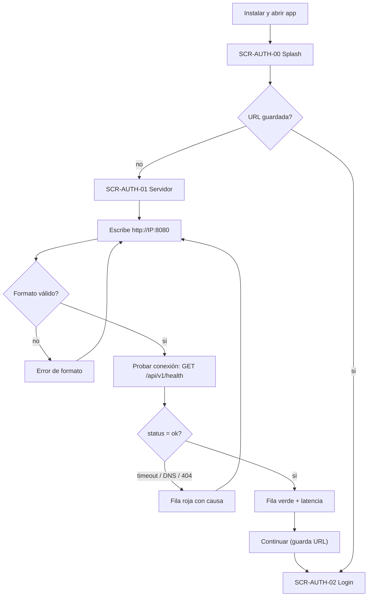

## 2. Login and session restore

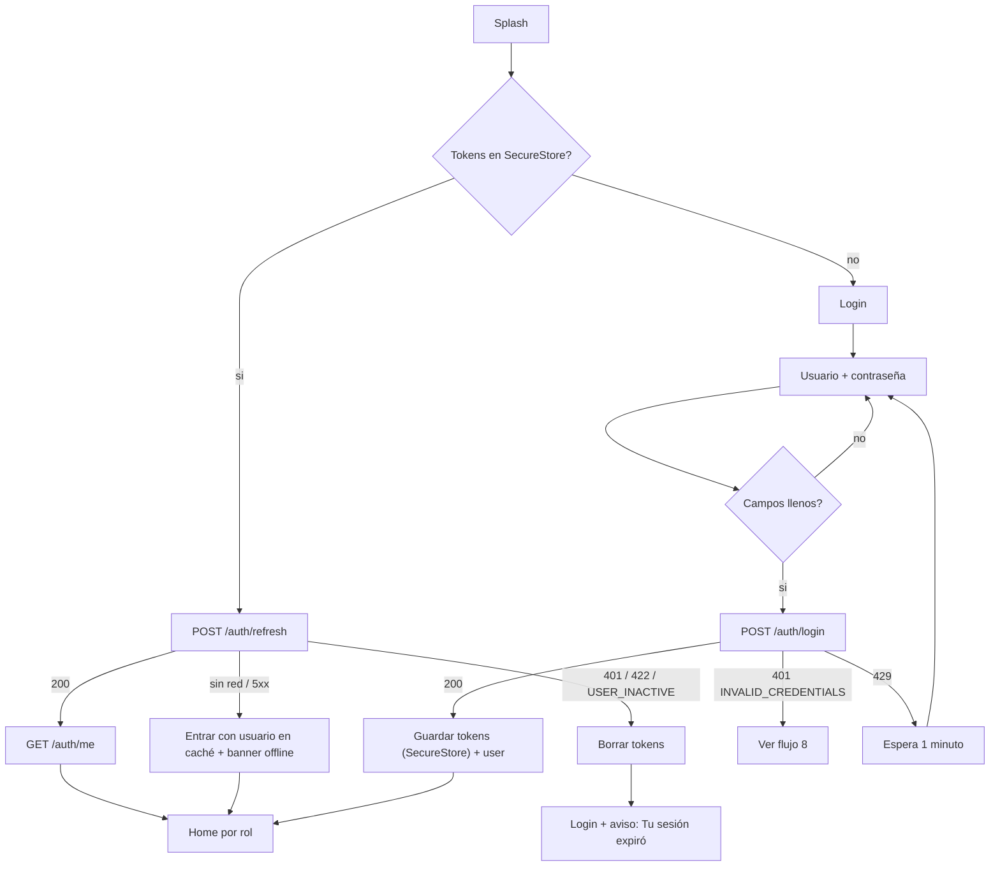

## 3. Role entry (D9)

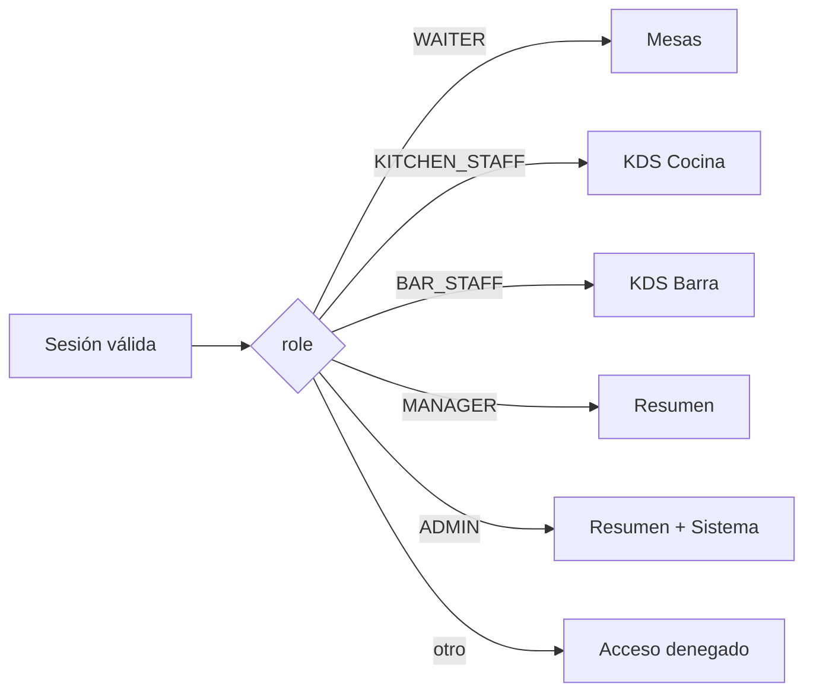

## 4. Waiter: select table, add items, modifiers, send

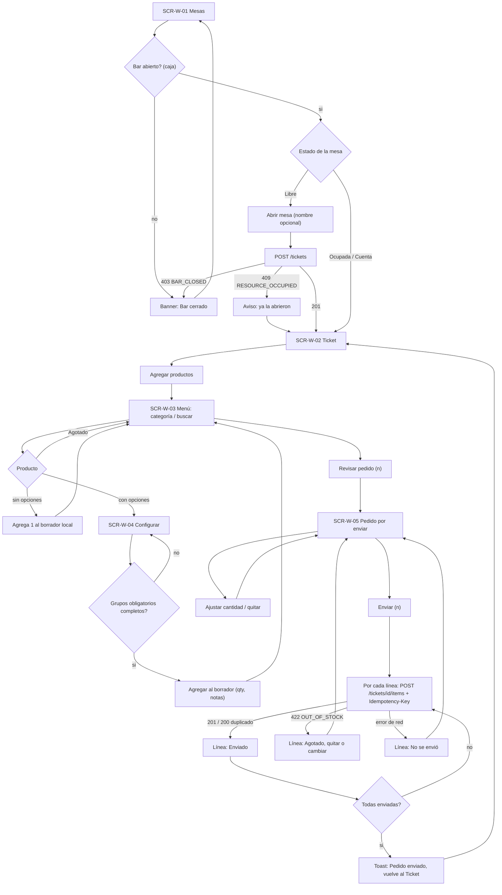

## 5. Kitchen: receive, progress

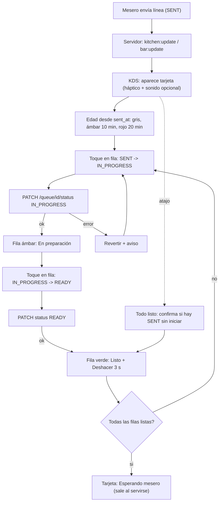

## 6. Waiter: ready, served

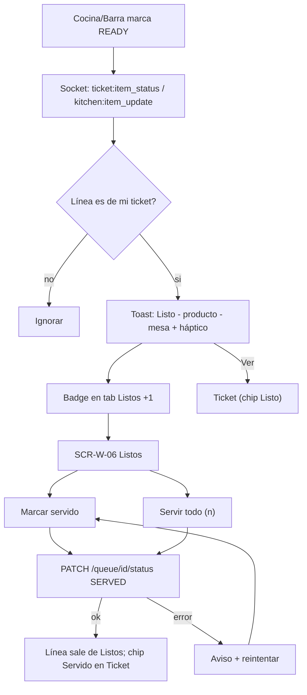

## 7. Manager review

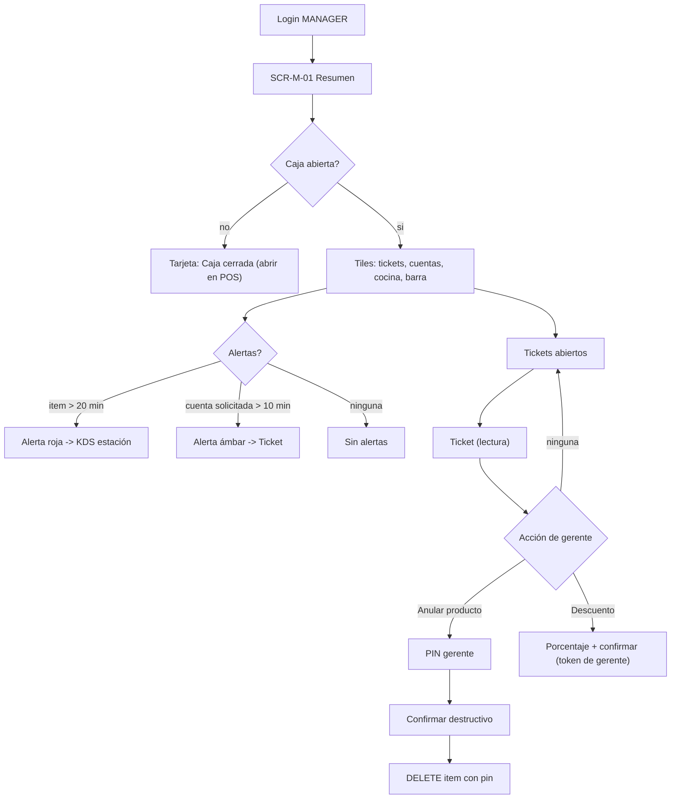

## 8. Network loss during send, and recovery

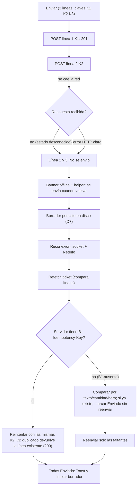

Rules: Enviar disabled while any request is in flight; line status is per line; keys are generated when the line is created in the draft (not at send time) and persisted with it.

## 9. Invalid credentials

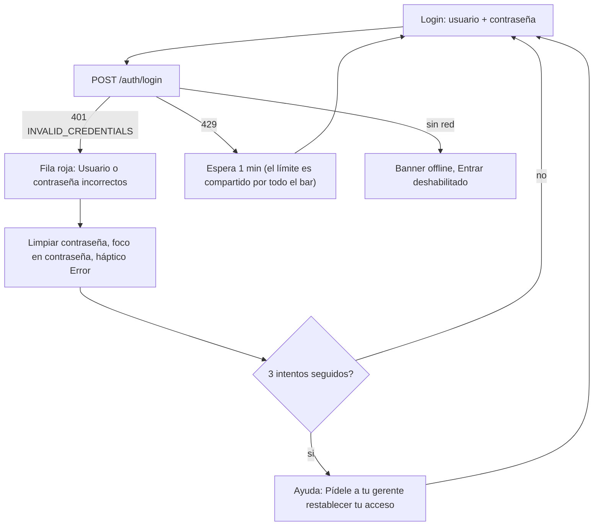

## 10. Authorization denial

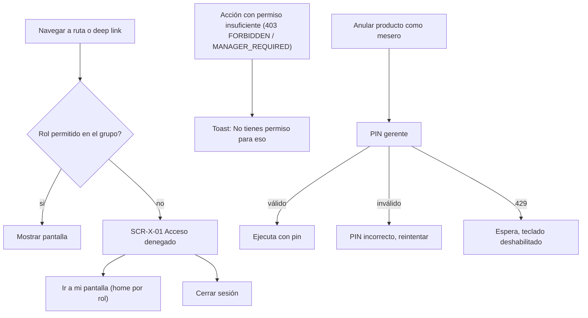

## 11. Logout

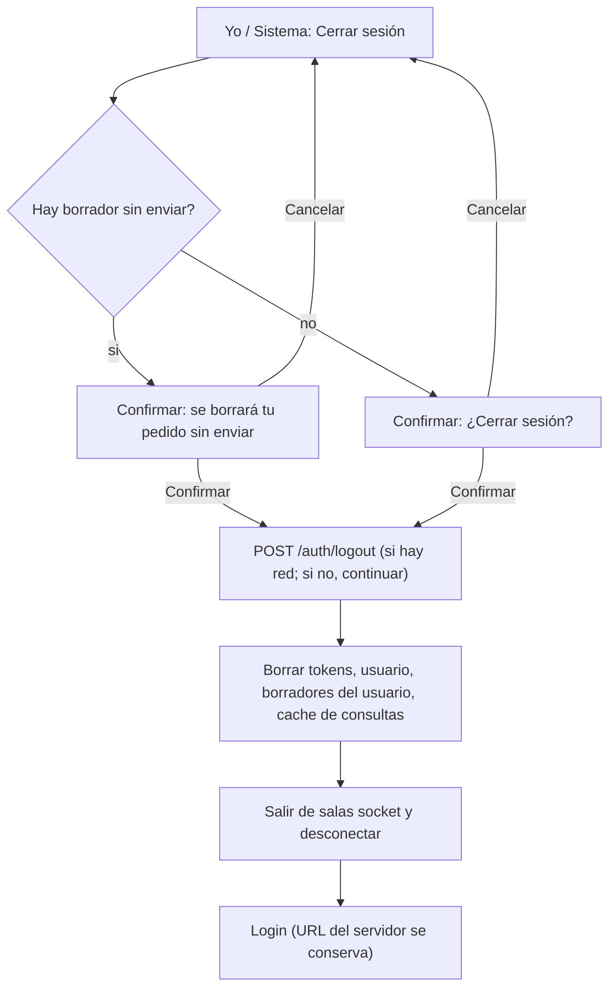

Note: `/auth/logout` only blocklists the access token; refresh token is NOT revoked server-side (G3) so the device-side wipe is the real logout.
